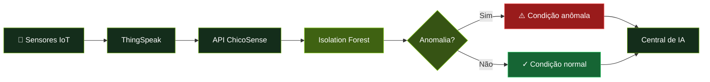
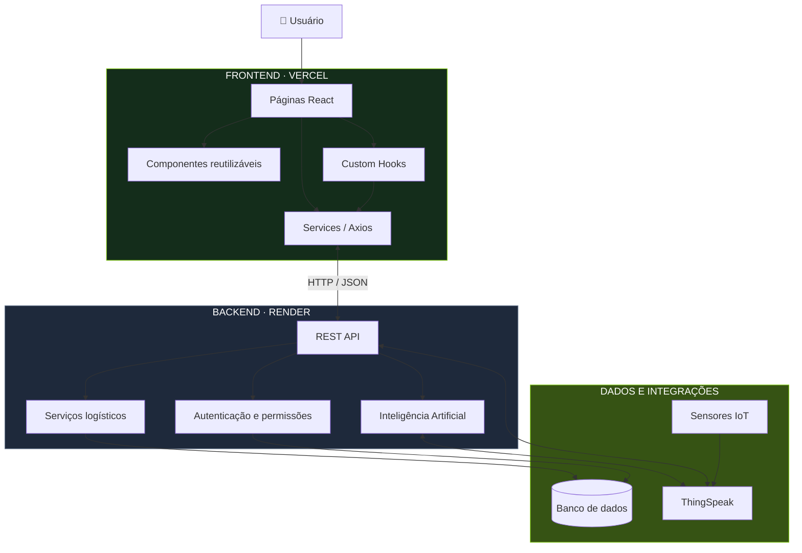
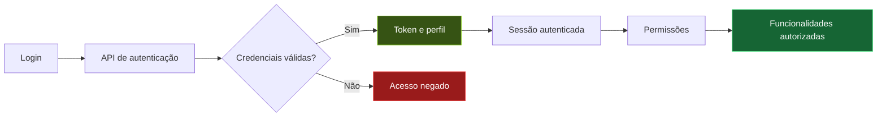
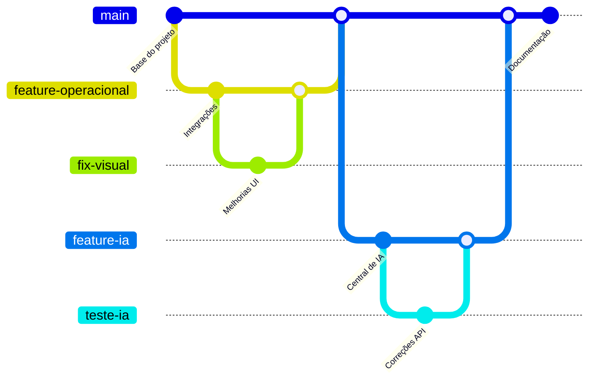

<div align="center">


<br/>


<br/>

<a href="https://chico-sense-frontend.vercel.app">
  
</a>
<a href="https://chico-sense-back.onrender.com/docs">
  
</a>

<br/><br/>

**Monitorar. Analisar. Prevenir. Transformar.**

Uma plataforma inteligente para uma cadeia agrícola mais conectada,
eficiente e sustentável.

<br/>

[Sobre](#-sobre-o-chicosense) •
[Funcionalidades](#-ecossistema-de-funcionalidades) •
[Tecnologias](#-technology-stack) •
[Arquitetura](#-arquitetura-da-solução) •
[Instalação](#-getting-started) •
[Equipe](#-equipe)

</div>

---

## 🌱 Sobre o ChicoSense

O **ChicoSense** nasce da necessidade de conectar tecnologia,
sustentabilidade e inteligência operacional à cadeia logística
de produtos agrícolas.

Durante o transporte, fatores como temperatura, umidade e
condições de armazenamento podem comprometer a qualidade
dos produtos, ocasionando perdas e impactos econômicos.

A plataforma propõe uma abordagem integrada, combinando
**Internet das Coisas (IoT)**, **Inteligência Artificial (IA)**
e **gestão logística** para transformar dados ambientais
em informações relevantes para a tomada de decisões.

> Mais do que monitorar dados, o ChicoSense busca transformar
> informações em decisões e decisões em prevenção.

<div align="center">

| 🌿 Sustentabilidade | 🧠 Inteligência | 📡 Conectividade |
|:---:|:---:|:---:|
| Redução de perdas | Detecção de anomalias | Monitoramento IoT |
| Conservação agrícola | Análise ambiental | Dados dos sensores |
| Eficiência operacional | Apoio à decisão | Rastreabilidade |

</div>

---

## 🎯 Nossa proposta

<table>
<tr>
<td width="50%">

### O problema

- Perdas durante o transporte agrícola.
- Condições ambientais inadequadas.
- Dificuldade de acompanhamento das cargas.
- Informações operacionais descentralizadas.
- Identificação tardia de riscos.

</td>
<td width="50%">

### Nossa solução

- Monitoramento ambiental integrado.
- Inteligência artificial aplicada à prevenção.
- Centralização das operações logísticas.
- Acompanhamento de indicadores.
- Apoio à tomada de decisões.

</td>
</tr>
</table>

---

## ⚡ Ecossistema de funcionalidades

<div align="center">

| Módulo | Descrição | Status |
|:---|:---|:---:|
| 📊 Dashboard | Indicadores e visão operacional | 🟢 |
| 🚛 Viagens | Gerenciamento do transporte | 🟢 |
| 📦 Cargas | Controle de produtos e cargas | 🟢 |
| 🚚 Frota | Veículos e motoristas | 🟢 |
| 📡 Monitoramento | Sessões e leituras ambientais | 🟢 |
| 🧠 ChicoSense IA | Detecção inteligente de anomalias | 🟢 |
| 🍃 Etileno | Análises e estimativas científicas | 🟢 |
| 🚨 Alertas | Monitoramento preventivo | 🟢 |
| 📋 Histórico | Rastreabilidade das operações | 🟢 |
| 👥 Administração | Empresas, usuários e permissões | 🟢 |
| ⚙️ Configurações | Preferências e informações da conta | 🟢 |

</div>

### 📊 Dashboard operacional

Central de informações estratégicas da plataforma.

- Indicadores de viagens em andamento.
- Cargas monitoradas.
- Sessões de monitoramento ativas.
- Alertas operacionais.
- Gráficos de temperatura e umidade.
- Atualização periódica dos dados IoT.

### 🚛 Gestão logística

Gerenciamento das operações de transporte agrícola,
desde o planejamento até o acompanhamento das cargas.

- Cadastro e gerenciamento de viagens.
- Controle de origem, destino e previsão de chegada.
- Associação de veículos e motoristas.
- Cadastro de cargas, produtos e caixas.
- Gerenciamento do ciclo operacional.
- Consultas com paginação incremental.

### 📡 Monitoramento ambiental

Integração com o ecossistema ThingSpeak para consulta
e processamento das informações coletadas pelos sensores.

- Monitoramento de temperatura.
- Monitoramento de umidade.
- Consulta de medições reais.
- Sincronização de leituras.
- Gerenciamento de sessões.
- Visualização gráfica dos dados ambientais.

### 🍃 Análises de etileno

Módulo dedicado ao acompanhamento de estimativas
relacionadas às condições de conservação dos produtos.

- Associação entre viagens, cargas e sessões.
- Registro e acompanhamento de análises.
- Estimativas científicas.
- Apoio à avaliação das condições dos produtos.

> As estimativas científicas não substituem medições
> diretas de concentração de etileno.

---

## 🧠 ChicoSense Intelligence

<div align="center">


</div>

A Central de Inteligência Artificial do ChicoSense utiliza
serviços de Machine Learning disponibilizados pelo backend
para identificar comportamentos ambientais anômalos.

O algoritmo **Isolation Forest** analisa medições e identifica
observações que apresentam características diferentes dos
padrões aprendidos pelo modelo.



### Recursos da central

<table>
<tr>
<td width="50%">

#### 📡 Monitoramento ThingSpeak

Consulta e análise de medições reais provenientes
da integração com os sensores.

</td>
<td width="50%">

#### 🧪 Medições personalizadas

Envio de valores personalizados para avaliação
pelo modelo de inteligência artificial.

</td>
</tr>
<tr>
<td width="50%">

#### 🧠 Monitoramento inteligente

Visualização dos resultados, pontuações e
classificações disponibilizadas pelo modelo.

</td>
<td width="50%">

#### 📈 Fatores analisados

Apresentação dos indicadores e gráficos
relacionados às condições ambientais.

</td>
</tr>
</table>

A inferência é executada no backend. O frontend é responsável
por consumir, interpretar e apresentar os resultados da API.

---

## 💻 Technology Stack

<div align="center">

### Frontend


<br/><br/>


### Integrações


### Ferramentas e infraestrutura


<br/><br/>


</div>

---

## 🏗️ Arquitetura da solução

O frontend foi estruturado utilizando componentização,
separação de responsabilidades e serviços especializados
para comunicação com o backend.



### Camadas da aplicação

| Camada | Responsabilidade |
|:---|:---|
| Presentation | Interfaces e componentes React |
| State Management | Estados e hooks reutilizáveis |
| Service Layer | Comunicação com os endpoints |
| Authentication | Sessão e identificação do usuário |
| Integration | Consumo de dados IoT e IA |
| Visualization | Gráficos, indicadores e resultados |

---

## 📁 Project Structure

```text
ChicoSense-Frontend/
│
├── public/
│
├── src/
│   │
│   ├── components/
│   │   ├── Cards/
│   │   │   ├── CentralInteligenciaIA.jsx
│   │   │   ├── FatoresAnalisadosIA.jsx
│   │   │   ├── MedicoesPersonalizadas.jsx
│   │   │   ├── MonitoramentoInteligente.jsx
│   │   │   └── MonitoramentoThingSpeak.jsx
│   │   │
│   │   ├── Charts/
│   │   │   └── GraficoMedicoesIA.jsx
│   │   │
│   │   ├── Header/
│   │   ├── Logistics/
│   │   └── UI/
│   │
│   ├── hooks/
│   │
│   ├── pages/
│   │   ├── Administracao/
│   │   ├── Alertas/
│   │   ├── Cargas/
│   │   ├── ChicoSenseIA/
│   │   ├── Configuracoes/
│   │   ├── Dashboard/
│   │   ├── Frota/
│   │   ├── Historico/
│   │   ├── Monitoramento/
│   │   └── Viagens/
│   │
│   └── services/
│       ├── api.js
│       ├── alertaService.js
│       ├── cargaService.js
│       ├── inteligenciaService.js
│       ├── logisticsService.js
│       ├── monitoramentoService.js
│       ├── sensorService.js
│       └── viagemService.js
│
├── index.html
├── package.json
├── vite.config.js
└── README.md
```

---

## 🔐 Security & Access Control

A plataforma utiliza autenticação baseada em token,
associada ao controle de acesso por perfil e vínculo empresarial.

<div align="center">

| Perfil | Escopo |
|:---:|:---|
| `ADMIN` | Administração da plataforma |
| `GESTOR` | Gerenciamento de operações autorizadas |
| `OPERADOR` | Execução de operações permitidas |
| `CONSULTA` | Visualização de informações autorizadas |

</div>



O frontend adapta a interface conforme as permissões
do usuário, enquanto o backend realiza a autorização
definitiva de cada operação.

---

## 🔌 API Reference

**Base URL**

```text
https://chico-sense-back.onrender.com
```

<details>
<summary><b>🔑 Autenticação</b></summary>

<br/>

| Método | Endpoint |
|:---:|:---|
| POST | `/api/v1/auth/login` |

</details>

<details>
<summary><b>🧠 Inteligência Artificial</b></summary>

<br/>

| Método | Endpoint | Descrição |
|:---:|:---|:---|
| GET | `/api/v1/ia/status` | Status do modelo |
| GET | `/api/v1/ia/historico` | Histórico de análises |
| POST | `/api/v1/ia/analisar` | Análise de medições |
| GET | `/api/v1/ia/thingspeak` | Análise de dados IoT |

</details>

<details>
<summary><b>📡 ThingSpeak e IoT</b></summary>

<br/>

| Método | Endpoint |
|:---:|:---|
| GET | `/api/v1/integracoes/thingspeak/feeds` |
| GET | `/api/v1/integracoes/thingspeak/ultima-leitura` |
| GET | `/api/v1/integracoes/thingspeak/status` |
| POST | `/api/v1/integracoes/thingspeak/sincronizar` |

</details>

<details>
<summary><b>🚛 Logística e monitoramento</b></summary>

<br/>

| Método | Endpoint |
|:---:|:---|
| GET | `/api/v1/viagens` |
| POST | `/api/v1/viagens` |
| GET | `/api/v1/monitoramento/resumo` |

</details>

<br/>

> Consulte o Swagger para verificar todos os endpoints,
> contratos, parâmetros e permissões disponíveis.

[](https://chico-sense-back.onrender.com/docs)

---

## 🚀 Getting Started

### Pré-requisitos

Antes de começar, certifique-se de possuir:

- Node.js compatível com o Vite utilizado.
- npm.
- Git.
- Acesso ao backend.

### 01 — Clone o repositório

```bash
git clone https://github.com/juvalent/ChicoSense-Frontend.git
```

### 02 — Acesse o projeto

```bash
cd ChicoSense-Frontend
```

### 03 — Instale as dependências

```bash
npm ci
```

### 04 — Configure o ambiente

Crie um arquivo `.env` na raiz do projeto.

```env
VITE_API_URL=https://chico-sense-back.onrender.com
```

> Não adicione `/api/v1` à URL base, pois os serviços
> já utilizam os caminhos completos dos endpoints.

### 05 — Execute a aplicação

```bash
npm run dev
```

Acesse:

```text
http://localhost:5173
```

### Scripts disponíveis

| Comando | Descrição |
|:---|:---|
| `npm ci` | Instalação das dependências |
| `npm run dev` | Ambiente de desenvolvimento |
| `npm run build` | Build de produção |
| `npm run preview` | Visualização local do build |

---

## ☁️ Infrastructure & Deployment

<div align="center">

<table>
<tr>
<td align="center" width="50%">


### Frontend

**Vercel**

React + Vite

[Access Application](https://chico-sense-frontend.vercel.app)

</td>
<td align="center" width="50%">


### Backend

**Render**

REST API

[Access API](https://chico-sense-back.onrender.com/docs)

</td>
</tr>
</table>

</div>

### Configuração de produção

```yaml
Framework: Vite
Build Command: npm run build
Output Directory: dist
Production Branch: main
```

### Pipeline de integração


---

## 🌿 Git Workflow

O versionamento do projeto é organizado em branches
especializadas para desenvolvimento, correções e integração.



*Representação ilustrativa do fluxo de integração.*

### Conventional Commits

| Prefixo | Finalidade |
|:---:|:---|
| `feat` | Nova funcionalidade |
| `fix` | Correção de problemas |
| `refactor` | Reestruturação do código |
| `style` | Ajustes visuais |
| `docs` | Documentação |
| `test` | Testes |
| `merge` | Integração de branches |

---

## 🧩 Engineering Principles

<table>
<tr>
<td width="50%">

### Architecture

- Componentização.
- Separação de responsabilidades.
- Serviços especializados.
- Reutilização de hooks.
- Organização modular.

</td>
<td width="50%">

### Performance

- Lazy loading de páginas.
- Code splitting.
- Paginação incremental.
- Build otimizado.
- Atualização periódica de dados.

</td>
</tr>
<tr>
<td width="50%">

### User Experience

- Identidade visual consistente.
- Indicadores operacionais.
- Feedback de carregamento.
- Tratamento de erros.
- Interfaces de monitoramento.

</td>
<td width="50%">

### Integration

- Comunicação via REST API.
- Autenticação baseada em token.
- Integração IoT.
- Consumo de serviços de IA.
- Controle de permissões.

</td>
</tr>
</table>

---

## 🗺️ Roadmap

### Phase 01 — Foundation

- [x] Estrutura inicial do frontend.
- [x] Componentes reutilizáveis.
- [x] Autenticação.
- [x] Navegação entre páginas.

### Phase 02 — Operational Management

- [x] Gestão de viagens.
- [x] Gestão de cargas.
- [x] Gestão de frota.
- [x] Administração.
- [x] Controle de permissões.

### Phase 03 — IoT Integration

- [x] Integração com ThingSpeak.
- [x] Monitoramento ambiental.
- [x] Gráficos de medições.
- [x] Sessões de monitoramento.
- [x] Alertas operacionais.

### Phase 04 — Artificial Intelligence

- [x] Central de inteligência artificial.
- [x] Integração com Isolation Forest.
- [x] Análise de medições personalizadas.
- [x] Análise de dados reais do ThingSpeak.
- [x] Integração com a branch de produção.

### Phase 05 — Continuous Evolution

- [ ] Aprimoramento visual do módulo de etileno.
- [ ] Ampliação dos testes automatizados.
- [ ] Revisão das dependências.
- [ ] Validação contínua das permissões.
- [ ] Otimização de desempenho.
- [ ] Evolução dos indicadores preditivos.

---

## 🌎 Impacto e sustentabilidade

<div align="center">


&nbsp;&nbsp;

&nbsp;&nbsp;


</div>

A proposta do ChicoSense está alinhada aos seguintes
Objetivos de Desenvolvimento Sustentável:

| ODS | Contribuição pretendida |
|:---|:---|
| ODS 2 — Fome Zero e Agricultura Sustentável | Apoio à conservação dos produtos agrícolas |
| ODS 9 — Indústria, Inovação e Infraestrutura | Aplicação de IoT e inteligência artificial |
| ODS 12 — Consumo e Produção Responsáveis | Apoio à redução de perdas e desperdícios |

---

## 👥 Equipe

O ChicoSense é resultado de um trabalho colaborativo,
integrando diferentes áreas da tecnologia.

<div align="center">


<br/><br/>

<a href="https://github.com/juvalent/ChicoSense-Frontend/graphs/contributors">
  
</a>

<br/><br/>

**Construído por pessoas que acreditam no potencial
da tecnologia para transformar o futuro.**

</div>

---

## 📊 Repository Insights

<div align="center">


</div>

---

<div align="center">

## 🌱 ChicoSense

### Technology with purpose.

*Connecting data, intelligence and sustainability.*

<br/>

**O futuro da agricultura também se constrói com tecnologia.**

<br/>

<a href="https://chico-sense-frontend.vercel.app">
  
</a>

<br/><br/>

Developed collaboratively with dedication, innovation and purpose.


</div>
