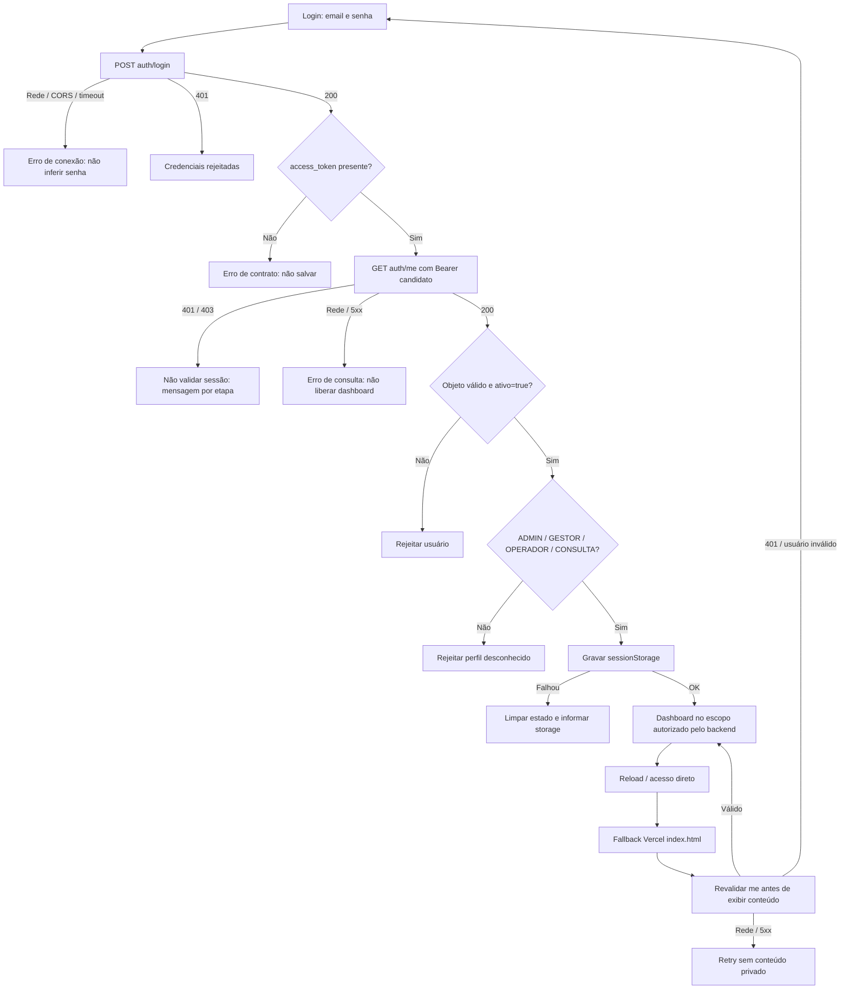

# Integração frontend–backend: autenticação e sessão

## Incremento 3 — administração — 24/11/2026

Na branch `feature-integracao-operacional-backend`, a rota `/administracao` e o
menu Administração são exclusivos de ADMIN ativo. As telas de empresas,
usuários e produtos permitem listar com paginação, cadastrar, editar e
ativar/inativar. Perfis de usuário são consultados em `/api/v1/perfis`;
seus UUIDs não são fixados no frontend. ADMIN continua sujeito às validações e
constraints do servidor; não há conexão direta com o banco na interface.

Empresas usam os tipos TRANSPORTADORA/PRODUTOR/CLIENTE. Alterar um tipo pode ser
recusado pela API quando houver relações logísticas incompatíveis. Não há
exclusão de empresa, usuário ou produto pela interface.

Usuários usam nome, e-mail, perfil e senha inicial de 12–128 caracteres.
Na edição, nova senha vazia é omitida do PATCH e mantém a credencial existente.
Senhas não são aparadas, registradas em logs ou gravadas em storage; o campo é
limpo após falha e descartado ao concluir/cancelar o formulário. Nenhuma senha
ou hash existente é lido para edição. Quando o usuário editado é o próprio
administrador logado, o App revalida `/auth/me` pelo JWT atual. O evento local
`auth:refresh` só solicita revalidação; não recebe identidade/permissão por evento
nem concede privilégios. Alterar o papel da própria conta remove as opções
administrativas após a nova resposta do servidor.

Em Empresas → Vínculos, é possível listar os usuários com vínculo ativo e
selecionar um usuário de uma página do catálogo para vincular/reativar. O POST
usa empresa/usuário no caminho, e o backend valida a operação administrativa.
Criar um usuário não o vincula automaticamente a uma empresa. A API atual não
oferece remoção/desativação individual do vínculo: a UI não simula essa operação
por meio de exclusão, alteração de papel ou inativação de outro recurso.

Em Produtos → Parâmetros, é possível listar, criar e editar parâmetros daquele
produto. Campos Decimal seguem como strings no JSON, até oito dígitos inteiros
e quatro casas decimais; vírgula decimal é aceita no formulário. Comparações
mínimo/máximo usam inteiros escalados (BigInt), sem conversão por Number.
Ausência é null e zero explícito é preservado. Não há campo ativo nem rota de
inativação de parâmetro. Esses parâmetros do catálogo não modificam taxas de
etileno, regras científicas ou configurações ambientais de sessões.

Listas e seletores de usuários para vínculo usam páginas de 20 com um registro
adicional para determinar a próxima página. Mudança de seção, registro pai ou
página descarta formulários/detalhes do contexto anterior e cancela consultas
pendentes. Durante uma gravação, a mudança de contexto e o duplo envio ficam
bloqueados. Falhas 401/403/404/409/422 não viram sucesso ou ausência de dados;
em timeout não se repete POST automaticamente e a tela orienta consultar a
listagem antes de reenviar. Senhas não são incluídas em mensagens de erro.

Validação: 114 testes aprovados (78 anteriores + 36 novos), build concluído e
lint sem erros, com avisos preexistentes/tamanho do bundle. Testes usam HTTP
simulado e cobrem acesso direto/menu por perfil, empresas dos três tipos,
cadastro/edição/inativação, perfis, senha opcional e limpeza, precisão Decimal,
vínculos, paginação, falhas, envio duplo e revalidação da própria conta.
Não foram criadas contas/cadastros reais, alterado o backend, executadas migrations
ou realizado deploy/homologação visual em produção neste incremento.

Para homologar após publicação: usar uma conta ADMIN já existente, abrir
Administração, preparar empresas/produtos/usuários e criar seus vínculos
explicitamente. A conta Logística/GESTOR continua administrando somente a Frota
autorizada. Não se criou outra conta ADMIN nem se alteraram credenciais reais.

Pendências atuais: cadastro de cargas/caixas, transições de viagem/carga,
declaração PUT, operações de sessão/aquisição, avaliações/decisões e intervenção
virtual. A consulta autorizada de produtores/clientes para o GESTOR e o catálogo
de sensores continuam exigindo definição de backend. As listas de pendências
nos incrementos abaixo são registros históricos, não o estado atual.

## Incremento 2 — frota — 24/11/2026

Na branch `feature-integracao-operacional-backend`, a nova rota `/frota` permite
selecionar uma transportadora autorizada e gerenciar veículos e motoristas:

- ADMIN ou GESTOR vinculado à transportadora ativa: cadastrar, editar e
  ativar/inativar. Não há exclusão nem transferência de empresa em PATCH.
- OPERADOR/CONSULTA com vínculo ativo à transportadora: consultar, sem formulários
  de escrita. Produtor/cliente sem vínculo com transportadora não recebem o menu
  e não consultam a API ao tentar abrir a página diretamente.
- O catálogo de empresas é paginado e filtrado por tipo TRANSPORTADORA. A API
  continua sendo a autoridade de escopo. IDs enviados não substituem autorização.
- Listagens de frota usam filtro empresa_id e páginas de 20 com um registro de
  verificação da próxima página, incluindo registros ativos/inativos. Documento
  de motorista fica no formulário autorizado de edição, sem impressão em logs.
- Payloads usam somente os campos dos contratos existentes; opcionais vazios
  tornam-se null. PATCH não inclui empresa_id. Nenhuma alteração de backend,
  schema, credencial, migration ou regra científica foi necessária.
- Erros 401/403/404/409/422 não viram sucesso/lista vazia. A gravação aguarda
  confirmação do servidor; duplo envio é bloqueado, assim como a troca de empresa
  durante o envio. Não há repetição automática de POST/PATCH em timeout. Nesse
  caso a tela orienta conferir a listagem antes de reenviar: o backend não oferece
  chave idempotente nesses cadastros e pode ter concluído a operação.
- Trocar empresa ou tipo de cadastro elimina o formulário e as linhas anteriores,
  cancelando consultas pendentes. Respostas de empresa diferente são rejeitadas.
- Inativar preserva o histórico; as consultas já existentes no formulário Nova
  viagem filtram ativo=true para veículos/motoristas.

Para testar: entrar com Logística/GESTOR, abrir Frota, selecionar a transportadora
DEMO, cadastrar um veículo e um motorista. Depois abrir Viagens → Nova viagem e
selecionar a mesma transportadora; o formulário consulta novamente suas opções.
Não realizar esse roteiro no banco de produção sem intenção de criar registros.

Validação local: 78 testes aprovados (55 anteriores + 23 deste incremento),
build concluído e lint sem erros; permanecem avisos preexistentes e de tamanho do
bundle. Os testes usam HTTP simulado, inclusive para permissões, escopo, edição,
inativação, paginação e falhas. Não se realizou cadastro real nem homologação
visual em Vercel nesta etapa. O código abaixo desta seção documenta incrementos
anteriores; sua lista de pendências é histórica. Permanecem pendentes a
administração de empresas/usuários/produtos, cargas/caixas, transições logísticas,
sessões operacionais, avaliações/decisões e intervenções.

## Incremento operacional inicial — 24/11/2026

Branch local `feature/integracao-operacional-backend`, baseada na main remota
`d6f05b1ada675d6de8a73277e1b55491eb880d05`, incluindo o CSS responsivo existente.
Sem commit, push ou deploy nesta etapa.

- Nova viagem e Nova análise consideram conta ativa, papel e vínculo ativo com
  TRANSPORTADORA. ADMIN mantém a abrangência administrativa; CONSULTA e usuários
  vinculados somente a produtor/cliente ficam sem essas ações. O servidor continua
  autorizando cada recurso: permissões visuais não garantem acesso a todos os IDs.
- A declaração da carga preserva o contrato retornado pelo backend, incluindo
  massa Decimal em string, maturação, lote hipotético, rastreabilidade e versão.
  Cargas e Configurações mostram esses dados, sem inferir pré-resfriamento ou limites.
- Alertas mapeiam nivel, iniciado_em e estados ABERTO/EM_ANALISE/RESOLVIDO/DESCARTADO.
  RESOLVIDO aparece como Resolvido; não comprova normalização do ambiente ou do gás.
- Dashboard e Integrações usam seleção explícita de viagem/sessão autorizada.
  Não consultam ThingSpeak global ou afirmam sucesso sem requisição. Sessões da
  viagem são paginadas; a consulta de leituras abre a última página de 100 registros
  e fixa a revisão nas páginas seguintes. Atualizar consulta a revisão atual.
  Mudança de seleção/erro elimina resultados anteriores, sem apresentar ausência
  de dados como produção zero. O gráfico é descritivo e não calcula etileno.
- O indicador de viagens em trânsito refere-se apenas à lista carregada. Os demais
  indicadores permanecem indisponíveis quando não há agregado real fornecido.

Validação: 55 testes locais com HTTP simulado; build Vite; lint. Não se utilizam
contas de produção nos testes. Permanecem avisos preexistentes de lint e tamanho
do bundle. Não houve homologação visual ou requisições ao banco nesta etapa.

Pendências para os próximos incrementos:

1. Administração ADMIN de usuários, empresas, vínculos, produtos e parâmetros;
   cadastro/edição de veículos e motoristas para ADMIN/GESTOR.
2. Cadastro/edição de cargas/caixas e transições de viagem/carga; declaração PUT.
3. Iniciar/encerrar/cancelar sessão, sincronização, qualidade e revisão auditável.
4. Configuração ambiental, avaliação, decisões/evidências e intervenção virtual.
5. Paginação de viagens/cargas/alertas e da página Monitoramento existente,
   indicadores agregados e histórico completo. Este incremento não corrige essas
   outras paginações e não representa cobertura completa das 76 operações.
6. Definir no backend catálogo autorizado de sensores/dispositivos e seleção de
   produtor/cliente para a transportadora. Não ampliar vínculos ou liberar dados
   globais como atalho. O código/backend não foi modificado nesta branch frontend.

O restante deste documento registra o contrato de autenticação já implementado.

Revisão: 24/11/2026. [Diagnóstico](diagnostico-login-vercel.md) · [Vercel](configuracao-vercel.md) · [Checklist](checklist-validacao-producao.md).

## URL e transporte

- API base: `https://chico-sense-back.onrender.com` (somente origem, sem /api/v1).
- Frontend: `https://chico-sense-frontend.vercel.app`; desenvolvimento: http://localhost:5173 ou http://127.0.0.1:5173.
- VITE_API_URL tem fallback para a API acima e é incorporada ao build; mudar variável remota exige novo build. [Referência Vite](https://vite.dev/guide/env-and-mode).
- Cada service inclui `/api/v1` uma única vez. Não apontar a base para `/docs`, `/auth`, para o frontend ou para localhost em Production.
- Requisições via Axios, timeout 60000 ms, Accept application/json. Não há cookie de autenticação nem withCredentials habilitado pelo cliente. O login usa JSON; GETs privados levam Authorization Bearer. Não colocar token em URL ou log.

## POST /api/v1/auth/login

Público; corpo obrigatório JSON. Email é aparado no frontend; senha não é aparada. Nenhum papel, empresa_id ou hash deve ser enviado.

```http
POST /api/v1/auth/login
Content-Type: application/json
Accept: application/json
```

```json
{"email":"usuario@example.com","senha":"SENHA_FICTICIA_SUBSTITUIR_NO_TESTE_AUTORIZADO"}
```

Resposta estrutural ilustrativa (não é token válido nem credencial para produção):

```json
{"access_token":"<JWT_RETORNADO_PELA_API>","token_type":"bearer","expires_in":1800}
```

expires_in é expiração em segundos, configurável pelo backend (padrão local 30 min). O frontend exige token string não vazio e não libera conteúdo apenas por receber 200. Nenhum Bearer armazenado é anexado ao login.

| HTTP | Comportamento |
|---|---|
| 200 | Capturar token temporariamente e consultar /me |
| 401 | Credenciais inválidas/usuário inativo: mostrar rejeição de login, não continuar |
| 422 | Entrada inválida; verificar email/senha/limites |
| 503 | Configuração de autenticação indisponível; não tratar como senha errada |
| Sem resposta legível | Rede, timeout ou CORS: não inferir rejeição de credenciais |

## GET /api/v1/auth/me

```http
GET /api/v1/auth/me
Accept: application/json
Authorization: Bearer <JWT_RETORNADO_PELA_API>
```

O token candidato é enviado explicitamente antes de persistir a sessão. Resposta ilustrativa conforme CurrentUserResponse, com dados hipotéticos:

```json
{
  "id":"00000000-0000-0000-0000-000000000001",
  "created_at":"2026-11-24T10:00:00Z",
  "updated_at":"2026-11-24T10:00:00Z",
  "nome":"Usuário de teste",
  "email":"usuario@example.com",
  "ativo":true,
  "perfil_id":"00000000-0000-0000-0000-000000000002",
  "perfil":"OPERADOR",
  "empresas":[]
}
```

ativo é booleano no contrato publicado. Ausente, false, "true" ou 1 não é usuário ativo validado pelo frontend. perfil é string ou null no schema geral; a aplicação só aceita os quatro papéis oficiais conhecidos. Um papel desconhecido exige revisão do contrato, não alias silencioso. `empresas` é a lista de vínculos ativos descrita pelo backend; lista vazia não concede acesso global. ADMIN tem abrangência definida pelo servidor, não por essa lista no browser.

O nome apresentado usa `nome`→`name` apenas para compatibilidade visual. Esse mapeamento não altera autorização.

## Papéis e isolamento

| API / frontend | Rótulo | Regras backend relevantes |
|---|---|---|
| ADMIN | Administrador | Administração global; catálogo global e ThingSpeak global; endpoints ainda validam estado/integridade |
| GESTOR | Gestor | Escopo empresarial ativo; gestão de frota e configurações ambientais; ações privilegiadas de simulação |
| OPERADOR | Operador | Operações logísticas/monitoramento no escopo; sem gestão de frota/configuração ambiental privilegiada |
| CONSULTA | Consulta | Leitura no escopo; não escreve |

Esses nomes permanecem **exatamente iguais**, inclusive maiúsculas. PRODUTOR, TRANSPORTADORA e CLIENTE são tipos de empresa; produtor/logistica/cliente eram personas do frontend antigo e não são sinônimos dos papéis. Não há modo de escolher um perfil/empresa para obter permissão. O backend confere vínculos e ancestralidade de recursos a cada requisição. Ler um ID não autoriza enviá-lo como credencial. A UI não substitui essa validação.

As permissões por endpoint devem ser consultadas no backend: [contrato consolidado](https://github.com/RenataGusmao/chico_sense_back/blob/816bc4b728c711065cf01567c3bac491210e2277/docs/chicosense/contratos-api.md). Esta correção não redesenha todos os controles de escrita das telas nem cria novas permissões.

## JWT, storage e restauração

O código backend lido assina HS256 e exige sub UUID, iat, exp, iss/aud chicosense-api e type=access; consulta usuário ativo. Não foi inspecionada assinatura/chave/token de produção. O frontend trata o JWT como **opaco** e valida identidade/papel por /me, sem extrair permissões de claims não verificados.

Somente após POST, /me, ativo=true e perfil reconhecido, a UI salva `chicosense_token` em **sessionStorage**, chama o App e navega para /dashboard. Não salva senha nem objeto de usuário como prova de identidade. Falha limpa token candidato e o campo de senha. Storage negado impede conclusão com mensagem explícita.

sessionStorage é separado por origem/aba e dura a sessão da aba; não é cookie httpOnly e continua sujeito a risco de XSS. Nenhuma alteração de política de armazenamento foi feita neste patch. Não há refresh/logout remoto; Sair remove token e estado local. Não há garantia de revogação de JWT já emitido pelo simples logout local.

No reload com token: o App mostra “Verificando sessão…”, consulta /me e só então exibe rotas. 401/usuário inválido/perfil desconhecido limpa sessão. Falha de rede/5xx/429 mantém o token sem mostrar conteúdo privado e permite retry ou voltar ao login. A restauração não faz novo POST de senha.

## Interceptors e concorrência

1. Login e /health não enviam Bearer, inclusive se restar um header indevido na configuração.
2. Outras requisições recebem token armazenado apenas se não houver Authorization explícito; /me usa token candidato explicitamente.
3. O interceptor só emite auth:expired em 401 privado quando o Authorization enviado corresponde **ao token atualmente armazenado**.
4. O primeiro 401 limpa o token; outro 401 simultâneo da mesma sessão não dispara nova expiração. Um 401 tardio de token antigo não apaga login novo.
5. Falha de rede e 403 não significam sessão expirada. GET /health é somente conectividade de processo, não valida senha, JWT, banco ou vínculo.
6. Os logs do interceptor limitam-se a método/path/status/code, sem senha/Bearer. Outras páginas ainda podem registrar objetos de erro brutos; não copiar o console inteiro ou HAR sem revisão de dados sensíveis.

## Erros por etapa

| Falha | Tratamento |
|---|---|
| POST 401 | Email/senha incorretos; não chega ao /me |
| POST 200 sem token | Resposta incompatível, sem armazenamento |
| /me 401 | “Login retornou um token, mas API recusou consulta do usuário”; não afirmar senha incorreta |
| /me 403 | Acesso sem permissão |
| /me 200 malformado | Rejeitar resposta |
| ativo não true | Rejeitar usuário |
| perfil desconhecido/null | Rejeitar perfil; não promover/alias |
| Erro ao salvar sessionStorage | Não entrar; informar limitação do navegador |
| Timeout | Mensagem de demora; não classificar como senha |
| Sem resposta legível | Mensagem de conexão; usar checklist para separar rede/CORS |
| HTTP 409/422/503 | Respeitar mensagem/validação e estado; não limpar sessão como se fosse 401 |

Erros FastAPI podem ter detail string ou lista de {type,loc,msg}. O cliente normaliza ambos. Senha/token nunca devem fazer parte de mensagem apresentada ou evidência compartilhada.

## Fluxo com erros



## Evidências de validação

[tests/auth.test.js](../tests/auth.test.js): 23 casos de contrato/papéis/ativo/token/mensagens e concorrência. [tests/App.test.jsx](../tests/App.test.jsx): 14 casos com UI/rotas reais e HTTP mockado, incluindo dashboard/viagens/configurações para quatro papéis, reload e expiração. Não validam assinatura real de JWT nem permissões do banco; isso pertence aos testes do backend e à homologação autorizada.
