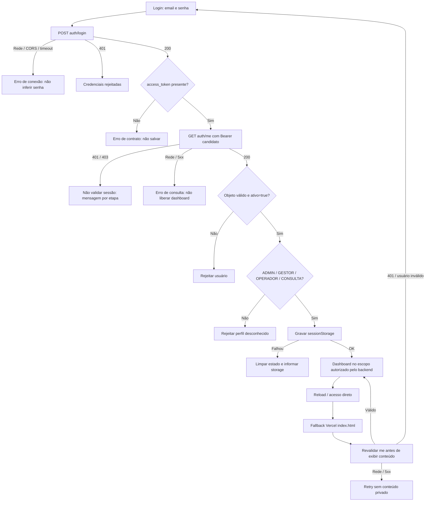

# Integração frontend–backend: autenticação e sessão

## Incremento 10 — contratos operacionais do backend — 24/11/2026

Integração validada sobre a branch já publicada em f07aa46. Após a validação,
o usuário autorizou os commits e a publicação somente das duas branches de
desenvolvimento, sem merge, migration remota ou deploy manual. Requer o backend da branch
`feature/integracao-operacional-frontend` e a migration `20261124_0011_parceiros`.
Publicar somente o frontend não libera os novos contratos.

- Administração → empresas → vínculos de uma transportadora ativa → Gerenciar
  parceiros comerciais: ADMIN aprova/reativa/revoga produtor ou cliente, com
  justificativa. Isso não cria associação de usuário nem amplia escopo de cargas.
- Cadastro de carga usa GET `/api/v1/transportadoras/{id}/parceiros?tipo=...`.
  A transportadora vem da viagem, jamais de campo livre para contornar autorização.
  GESTOR/OPERADOR só selecionam parceiros aprovados; ADMIN conserva alcance global.
  Nova carga revalida essas aprovações no backend. Histórico antigo é preservado.
- Em declaração/sessões da carga, ADMIN dispõe de Cadastro de sensores: novo
  dispositivo e seus sensores vinculados à carga/viagem/veículo. Nenhum segredo,
  leitura ou comando de hardware é produzido. ThingSpeak exige configuração
  separada da origem de ingestão, conforme fluxo administrativo existente.
- No início de sessão, data/ambiente explícitos consultam GET
  `/api/v1/cargas/{id}/sensores-disponiveis`. A primeira sessão já não depende de
  sensor presente no histórico. O catálogo atual é obrigatório para confirmar,
  paginado e restrito ao contexto. Reserva e estado são revalidados no POST.
  O histórico ainda reconcilia tentativas incertas e detecta sessão já aberta.
- Dashboard usa GET `/api/v1/monitoramento/resumo`: contagens globais dentro do
  escopo autorizado; ausência/falha do resumo é indisponibilidade, nunca zero.
  A tabela de viagens continua representando somente as viagens carregadas.
- Leituras/qualidade enviam revisão zero explicitamente. Qualidade pede
  `incluir_intervalos=false`; intervalos são consultados em páginas de 20 por GET
  `/api/v1/monitoramentos/{id}/qualidade/intervalos`, com mesma revisão/janela/G.
  O backend ainda precisa calcular a sequência completa: não se declara memória
  constante ou mudança no modelo de cobertura. Clientes antigos continuam aceitos.

Os cadastros administrativos não usam UUID idempotente: PUT de aprovação reutiliza
o mesmo par, e o identificador global de dispositivo impede duplicação silenciosa.
Após resposta incerta, consultar catálogo antes de novo cadastro. A interface mantém
o mesmo corpo em memória se o usuário decidir repetir. Não há repetição automática.

Validação: 321 testes aprovados (305 anteriores + 16 novos), build aprovado e lint
sem erros, preservando avisos legados. Os mocks anteriores agora incluem catálogo
atual e aprovação comercial. O teste de navegação por três rotas lazy recebe até
15 segundos para o fluxo completo, preservando as verificações de JWT e perfil.
Os testes novos verificam catálogo cruzado, primeira sessão, revisão zero, resumo
incompleto, paginação de intervalos, aprovação justificada e cadastro sem segredo.
Os novos controles não foram homologados contra o Render/Vercel nesta etapa.

Backend correspondente validado em PostgreSQL portátil 17.11: 831 testes da suíte
aprovados, zero falhas/skips, um warning conhecido; 12 testes PostgreSQL e uma
repetição de nove concorrentes passaram, além de uma checagem HTTP/JWT adicional
dos novos contratos. Nenhuma dessas execuções usou banco remoto.

Para a equipe: aplicar primeiro a migration autorizada e publicar o backend;
depois publicar esta branch em Preview, configurar VITE_API_URL de Preview e
conferir a origem exata do preview no CORS do Render. Usar somente o conjunto de
demonstração quando a API apontar para o banco real. O relatório do backend contém
contratos completos e roteiro por ADMIN, GESTOR, produtor e cliente.
Sem migração automática, merge, alteração da main, seed remoto ou deploy.

## Incremento 9 — paginação legada, desempenho e inspeção visual — 24/11/2026

Implementação validada localmente na mesma branch. Após a validação, o usuário
autorizou o commit e a publicação exclusivamente da branch de desenvolvimento.
Essa publicação não inclui merge, alteração da main ou deploy manual.
Backend, banco real, credenciais, autenticação e motor científico preservados.
Esta seção atualiza as pendências históricas dos incrementos anteriores.

### Listas e acesso aos registros seguintes

- A lista compartilhada de viagens usa páginas incrementais de 20, com uma
  sentinela adicional (`limit=21`, `offset=0,20,40…`). Carregar mais viagens
  amplia as opções nas telas sem uma varredura automática da base.
- Cargas nas telas Análises de Etileno e Configurações usam o mesmo controle.
  Sessões nas análises e nas leituras do dashboard também são incrementais;
  o dashboard deixou de percorrer automaticamente todas as páginas de sessões.
- A Central de Alertas seleciona viagem → carga → sessão e abre o painel
  preventivo completo, com evidências e decisões já autorizadas. Não depende
  de uma declaração atual para consultar alertas históricos nem agrega todas
  as sessões em chamadas simultâneas. O filtro ABERTO/EM_ANALISE/RESOLVIDO/
  DESCARTADO é enviado ao servidor e reinicia a paginação dos alertas.
- O histórico de análises permite páginas anteriores/próximas de 20. O resumo
  identifica a análise mais recente **na página**, sem sugerir um total global.
- No Histórico, o resumo de produtos consulta até 20 cargas por viagem, com
  concorrência limitada a quatro e cache em memória enquanto a tela permanece
  montada. Atualizar invalida o cache. Os detalhes permitem carregar as demais
  cargas explicitamente. Filtros de produto no resumo continuam parciais e
  isso aparece na interface; pesquisa global exige contrato do backend.

AbortController e identificação do contexto impedem que respostas atrasadas
sejam incorporadas a outra seleção. Páginas repetidas ou IDs incompatíveis
geram erro e pedem atualização, sem laços automáticos. Falhas e respostas
malformadas não são convertidas em zero registros bem sucedidos. Listagens
incrementais mantêm os registros anteriores se a próxima página falhar.
Paginação por offset não fixa um snapshot: inserções concorrentes podem alterar
a lista; repetição detectada exige atualização. Paginação por cursor/snapshot
consistente continua sendo uma possível melhoria de contrato no servidor.

### JavaScript por tela

React.lazy/Suspense divide as rotas e apresenta carregamento da página.
O build anterior tinha arquivo principal de 897,09 kB; o atual tem 333,42 kB
(109,28 kB gzip), cerca de 63% menor nesse arquivo. O maior chunk atual tem
371,67 kB (gráficos/leituras); não há chunks acima de 500 kB nem o aviso anterior.
O dashboard ainda carrega o chunk dos gráficos quando acessado: não se afirma
redução equivalente no tráfego total ou no tempo real de carregamento.
Não houve benchmark de rede, Lighthouse ou teste de carga do serviço publicado.

### Inspeção visual reproduzível e isolada

Executar `npm run dev -- --host 127.0.0.1 --port 5174 --strictPort` e abrir
`http://127.0.0.1:5174/tests/browser-qa.html`. Fixture de testes fora da entrada
do build de produção, limitada a localhost/127.0.0.1, com dados inteiramente
fictícios. Axios usa adapter local, bloqueia todas as gravações e nunca delega
requisições não reconhecidas à rede. O token fictício não é JWT nem credencial.
A fixture serve para composição visual, não valida integridade de negócio.

Conferidos no navegador: desktop 1280 px, iframe mobile de 390 px, seleção de
carga na segunda página (25ª carga), abertura de configuração preventiva,
campos/justificativas/botões mobile e solicitação exclusivamente virtual no
desktop. CONSULTA não mostrou botões de configuração ou avaliação. No painel
mobile inspecionado, largura do conteúdo e da área útil coincidiram em 374 px
(390 menos scrollbar), sem overflow horizontal. Ajustados espaçamento,
largura dos textareas, fieldsets e quebra de evidências. Capturas guardadas
nos outputs do workspace da conversa, sem dados de produção.
O servidor temporário foi encerrado após a inspeção.

### Validação e fronteira restante

305 testes aprovados em 11 arquivos (291 anteriores + 14 novos). Build aprovado,
lint sem erros; continuam avisos de código preexistente nas telas legadas.
Os mocks antigos de sessões passaram a informar viagem/carga como no contrato
real. O teste de login aguarda até cinco segundos pela primeira rota lazy;
as verificações de autenticação e papel foram preservadas.

Ainda dependem do backend, conforme decisão de adiar essas alterações:
totais globais e filtros agregados autorizados, catálogo/provisionamento de
sensores, consulta comercial de produtores/clientes para GESTOR e paginação
de intervalos de qualidade. O dashboard mostra indisponibilidade quando não
há agregado e delimita as contagens às viagens carregadas; não fabrica totais.
O vínculo opcional de análise no formulário preventivo permanece omitido,
conforme incremento 7; isso não bloqueia a avaliação ambiental nem a referência
contextual já disponível nas intervenções virtuais.
Integração ponta a ponta com Vercel/Render e dados reais ainda exige publicação
autorizada e validação nesse ambiente. A inspeção local não substitui essa etapa.

## Incremento 8 — autorização humana e exaustão virtual — 24/11/2026

Em Cargas ou Monitoramento → sessão → Abrir intervenções virtuais.
Listagem paginada, detalhe atualizado e trilha ordenada das ações são consultas
sem efeitos colaterais. Pedido exige justificativa e duração decimal explícita
maior que zero e até 86400 segundos. Não envia estado, relógio, dispositivo,
comando físico nem credenciais. Referência é opcional; seleção paginada de
alerta aberto/em análise, avaliação ou análise de etileno da mesma sessão,
sem entrada livre de UUID. A referência selecionada é exibida antes de confirmar.

Solicitar não autoriza nem inicia. O detalhe GET atual fornece ações permitidas;
ADMIN/GESTOR da transportadora podem atuar conforme esse retorno. OPERADOR
somente retira solicitação própria ainda SOLICITADA ou encerra execução própria,
conforme autorização atual. CONSULTA e vínculos externos não têm comandos.
O backend revalida estados, referências, ocupação e permissões a cada gravação.

AUTORIZAR, RECUSAR, INICIAR, ENCERRAR, CANCELAR e REGISTRAR_FALHA abrem formulário
de justificativa antes do POST. Cada tentativa usa UUID idempotente; resposta
incerta congela dados e preserva corpo/chave ao fechar/reabrir o mesmo formulário.
Não há polling, scheduler, POST automático, encerramento por temporizador ou
comando ao hardware. Prazo excedido é a projeção retornada no instante da consulta.
Encerramento administrativo permitido pelo backend continua acessível após fim
da sessão. Avisos de contexto alterado, ocupação e sessão terminal com execução
pendente permanecem visíveis. Estado virtual não comprova remoção de etileno.

Consultas rejeitam identidades incompatíveis de sessão, viagem, carga, modalidade
ou ações desconhecidas. Históricos compartilhados agora também conferem vínculo
com alerta/intervenção solicitados; confirmação de UUID é exigida nos contratos
que o retornam. Foram acrescentados testes das quatro decisões de alerta e de
evidência cruzada, além dos testes específicos de intervenção.

Validação final: 291 testes aprovados em 10 arquivos (64 novos desde os 227 do
incremento 6), build aprovado e lint sem erros; persistem avisos anteriores e
bundle acima de 500 kB. HTTP inteiramente simulado nos testes: não houve acesso
ao banco real nem alteração do backend. Sem push ou deploy. Homologação visual
e integração autenticada no ambiente publicado continuam pendentes.

Antes de considerar toda a interface concluída, revisar paginação das páginas
legadas (inclusive a lista central de viagens e a Central de Alertas), agregados
de dashboard e desempenho; as listas dos novos painéis já são paginadas.
O formulário preventivo ainda omite vínculo opcional à análise de etileno;
o fluxo de intervenção permite essa referência contextual. Catálogo de sensores,
consulta comercial para GESTOR e melhorias de escala do backend permanecem
registrados como adiados abaixo, sem contornar autorização no frontend.

## Incremento 7 — avaliação preventiva e decisões humanas — 24/11/2026

Em Cargas ou Monitoramento → sessão → Abrir avaliação preventiva e alertas.
A Central de Alertas aponta para esse fluxo. Consultas não executam avaliações.
Configurações, avaliações, alertas, decisões e evidências têm paginação de 20.
Detalhes são consultados pela sessão; identidades incompatíveis são rejeitadas.

ADMIN/GESTOR da transportadora podem registrar versões imutáveis de configuração.
GESTOR/OPERADOR da transportadora e ADMIN podem avaliar e decidir; CONSULTA e
vínculos externos somente consultam. A autorização final permanece no backend.
Sem valores ambientais predefinidos: faixas, G, cobertura, fundamento, prioridade,
justificativa e referências são explícitos; maturação/ambiente vêm da sessão.
Decimais são enviados como strings, com validação por inteiros escalados.

Avaliação exige início/fim/corte não futuros e dentro da sessão; revisão vazia
usa a última consolidada no corte, zero representa ausência de aquisição.
Uma configuração é selecionada diretamente em sua página; sem configuração
o backend registra insuficiência. A análise de etileno contextual é omitida
neste formulário: não se inventam referências nem se misturam janelas.
O resultado imutável, limitações e snapshot ficam consultáveis. Risco científico
de etileno permanece NAO_AVALIADO, separado da prioridade operacional.

Reconhecer, observar, resolver e descartar exigem justificativa. Estado terminal
aceita observação, sem reabrir; resolver não comprova normalização de gás.
Timeout/5xx retêm corpo e UUID em memória; repetição somente manual e idêntica,
inclusive ao fechar/reabrir o formulário no mesmo painel. Recarregar a página
perde essa memória: consultar históricos antes de iniciar nova tentativa.

Validação inicial: 249 testes aprovados (22 novos), build aprovado e lint sem
erros, com avisos preexistentes; bundle ainda acima de 500 kB. Nenhum acesso
ao banco real, backend, motor científico ou deploy. Homologação visual e teste
integrado no ambiente publicado permanecem pendentes. Mudanças de backend
continuam explicitamente adiadas na seção correspondente abaixo.

## Incremento 6 — aquisição, revisões e qualidade IoT — 24/11/2026

Entrega somente no frontend, conforme orientação de adiar mudanças de backend.
Na consulta de uma sessão, Abrir aquisição e qualidade carrega as tentativas,
leituras e controles operacionais. O painel funciona nas páginas Cargas e
Monitoramento. Abrir/consultar não inicia coleta. O backend, as credenciais,
o banco real e o motor de etileno não foram modificados.

### Sincronização explícita

POST `/api/v1/monitoramentos/{sessao_id}/sincronizacoes`, com origem BANCO ou
THINGSPEAK escolhida pelo usuário, início/fim explícitos dentro da sessão,
limite de requisições inteiro entre 1 e 32 (padrão operacional da API: 16),
limite de atraso opcional positivo em segundos e chave idempotente UUID.
Nenhuma API key/canal/token é solicitado no formulário. BANCO reassocia apenas
medições externas de fontes vinculadas, não fabrica leituras nem descobre novos
dispositivos. THINGSPEAK usa a configuração privada já existente do backend.

ADMIN/GESTOR/OPERADOR da transportadora podem sincronizar sessão ATIVA.
Complementação de ENCERRADA exige ADMIN/GESTOR, confirmação explícita e
justificativa. CANCELADA permite leitura, sem incorporação. CONSULTA e vínculos
somente com produtor/cliente não recebem escrita. O backend valida tudo de novo.
Se outra execução estiver registrada, a UI informa o fato e o servidor decide
se a nova solicitação é conflitante ou se pode substituir uma execução expirada;
o browser não expira leases nem inventa regras de concorrência.

HTTP 202/EM_EXECUCAO mantém a solicitação pendente e nunca anuncia coleta
concluída. CONCLUIDA, PARCIAL, FALHA e INTERROMPIDA são mostrados como estados da
tentativa auditada, com contadores retornados; ausência de contador não vira
zero. Não se equipara estado HTTP/execução a qualidade científica ou risco.

Duplo envio é bloqueado. Não há reenvio, polling ou sincronização automáticos.
Em timeout/5xx ou execução pendente, o conteúdo/chave ficam preservados e os
campos bloqueados; reconsultar manualmente envia o mesmo payload/chave. Fechar
e reabrir o formulário na mesma sessão mantém a tentativa em memória. Consultar
tentativas permite reconhecer chave/autor já registrados sem outro POST. Sair
da sessão/página perde o rascunho local: antes de nova solicitação, consultar o
histórico. Não se armazenam credenciais ou esses rascunhos no storage.

### Leituras, janela e revisão

GET sincronizacoes é paginado em 20 tentativas + uma para determinar próxima
página. Revisões em execução não são oferecidas como revisões consolidadas.
Selecionar a última revisão deixa a API resolver a revisão consolidada atual;
as páginas seguintes mantêm o número e a janela retornados.

GET leituras resolve metadados primeiro, abre a última página de 100 registros
e fixa início/fim/revisão ao paginar. Há filtro de temperatura/umidade e janela
opcional dentro da sessão. São preservados valor indisponível, estado inválido,
conflito, atraso desconhecido, fora de ordem, chegada após encerramento e
ocorrências. Não se removem silenciosamente barreiras temporais, interpolam
leituras ou convertem ausência em produção zero. Valor/unidade permanecem como
retornados, sem transformar temperatura/umidade em medição de gás.

A página Monitoramento anterior foi substituída pela seleção paginada de carga,
painel de sessões e este painel de aquisição. Foi removida a apresentação de
"última leitura" calculada sobre a primeira página de 100 registros, assim como
a comparação Ambiente × Produto que não era sustentada pelo contrato dessas
leituras. A navegação recebida de Cargas continua selecionando a carga correta.
Uma consulta direta da carga exige JWT e valida sua viagem antes de exibi-la;
IDs de navegação não substituem autorização do backend.

### Qualidade temporal

GET qualidade usa G operacional positivo, informado explicitamente, sem valor
científico pré-preenchido. O serviço JavaScript existente foi ajustado para
aceitar os parâmetros obrigatórios e o cancelamento da consulta. A requisição
fixa a mesma revisão/janela das leituras. O filtro de tipo restringe a tabela;
a qualidade continua considerando as fontes da sessão, conforme a API.

Mostram-se cobertura, duração coberta/não coberta, conflitos, inválidos e
classificação desconhecida de atraso. Percentual null continua Indeterminada.
Os intervalos de lacuna são apresentados em páginas locais de 20, com motivos
e horários retornados. Cobertura temporal de aquisição não é cobertura de
aplicabilidade de q(T), concentração, eficácia de exaustão ou classe de risco.
Nenhum cálculo científico ou limiar de etileno foi adicionado ao frontend.

Revisão 0 é exibida quando não há aquisição. A API não aceita `revisao=0` como
filtro, então a consulta omite esse parâmetro; se uma aquisição surgir no
intervalo e a resposta mudar de revisão/janela, a UI rejeita o resultado e
solicita atualização, em vez de misturar os contextos. Trocar sessão/janela
cancela consultas anteriores e oculta resultados de qualidade de outra janela.

### Alterações de backend explicitamente adiadas

**Não implementadas nem publicadas nesta entrega.** Registrar para trabalho
posterior, sem contornar as proteções atuais:

1. **Catálogo/provisionamento de sensores por contexto autorizado.** Necessário
   para a primeira sessão de carga sem histórico. Definir contrato e política
   de autorização para consultar sensores disponíveis àquela carga/viagem,
   distinguindo dispositivo ativo, tipo, unidade, vínculo e ambiente. Critérios
   futuros: sem JWT rejeitado; produtor/cliente/transportadora de outro escopo
   não descobrem dispositivos; sem chaves privadas nas respostas; sessão ainda
   revalida disponibilidade/conflitos ao iniciar. Cadastro/vínculo de hardware
   precisa de fluxo administrativo próprio. A UI atual continua oferecendo
   apenas sensores do histórico autorizado, sem campo livre para UUID; sem
   essas referências, o primeiro início permanece bloqueado.
2. **Seleção comercial de produtores/clientes para GESTOR.** Definir relação ou
   consulta autorizada apropriada para criar cargas. GET empresas atual lista
   vínculos do usuário e não é catálogo comercial global. Não adicionar vínculos
   extras ou liberar listagem global como atalho. ADMIN pode preparar as cargas
   até existir esse contrato.
3. **Escala e consultas agregadas.** Avaliar paginação de intervalos de qualidade
   no servidor: hoje a resposta retorna todos os intervalos e apenas a exibição
   é paginada no browser. Avaliar contrato explícito para fixar revisão 0 e
   indicadores/consultas agregados sem carregar histórico amplo. Nenhuma dessas
   mudanças foi simulada na API ou usada como se estivesse disponível.

### Validação e pendências de frontend

227 testes aprovados (192 anteriores + 35 novos), build concluído e lint sem
erros, com avisos preexistentes/tamanho do bundle. Testes usam HTTP simulado:
papéis/escopo, origens, complementação, 202, estados de falha/parcial,
idempotência/reconciliação, paginação de tentativas/leituras/lacunas, janela,
revisão, G obrigatório, null/zero, conflitos e qualidade indeterminada.
O mock do ciclo de sessões ganhou apenas as respostas das consultas reais de
viagem/carga introduzidas na nova seleção. Os 192 testes anteriores passaram.
Não houve leitura/gravação de produção, chamada real ao ThingSpeak, migration,
alteração no backend, deploy ou homologação visual em Vercel.

Próximos incrementos de frontend: configurações/avaliações preventivas,
evidências/decisões e intervenção virtual. A paginação da lista central de
viagens, agregados de Dashboard e demais consultas legadas ainda precisam de
revisão; este incremento não declara todos os fluxos do produto concluídos.

## Incremento 5 — declaração e ciclo de sessões — 24/11/2026

Na branch `feature-integracao-operacional-backend`, o painel Declaração e sessões
de monitoramento está disponível nos detalhes da carga e na página Monitoramento.
O caminho Cargas → Ir ao monitoramento mantém a seleção da viagem/carga recebida
pela navegação. O painel usa apenas rotas existentes; não altera backend,
entidades, migrations, credenciais, motor científico ou dados reais.

### Declaração

PUT `/api/v1/cargas/{carga_id}/monitoramento`: confirmação explícita de
MANGA_TOMMY_ATKINS, massa líquida em kg positiva (string Decimal, até oito dígitos
inteiros e quatro casas decimais), maturação, lote, indicador booleano de lote
hipotético e rastreabilidade. Vírgula decimal é aceita; vazio/zero/negativo/NaN
ou excesso de precisão são recusados antes do envio. Não se infere massa a
partir de quantidade logística, peso ou número de caixas. DESCONHECIDA é
preservada e não implica maturação conhecida nem taxas validadas para cultivar.
O usuário deve confirmar produto e natureza hipotética em uma nova declaração.

ADMIN ou GESTOR/OPERADOR da transportadora daquela viagem podem escrever, sujeitos
ao servidor. CONSULTA e vínculos somente com produtor/cliente ficam em leitura.
Declaração não é editável pela UI em carga/viagem terminal ou quando a página
carregada contém sessão ativa. Ausência de sessão ativa na primeira página não
prova ausência global: o backend continua verificando produto, estado e sessão
ativa em qualquer página e pode recusar com 409. Versão fica a cargo da API;
a UI não renumera declarações nem substitui snapshots de sessões anteriores.

### Sessões e sensores

Listagem de sessões por carga, paginada em 20 registros + um de verificação.
Consulta detalhada por GET `/api/v1/monitoramentos/{sessao_id}` valida carga/viagem
antes de mostrar o snapshot, a versão declarada na abertura, sensores, ambiente,
janela, observações e motivo de fim. A declaração atual e o snapshot histórico
podem diferir e permanecem apresentados separadamente.

Início por POST `/api/v1/cargas/{carga_id}/monitoramentos` exige declaração,
viagem EM_ANDAMENTO e carga EM_TRANSITO. Início efetivo é informado, convertido
do horário local para ISO UTC, deve respeitar o início real da viagem e não
ser futuro. Ambiente é escolhido explicitamente; sensores de temperatura e
umidade devem ser distintos. Umidade continua opcional conforme o contrato.
Criar sessão não sincroniza dados ou comanda sensores/hardware.

**Limitação de primeira sessão:** não existe catálogo HTTP de sensores no backend
atual. O formulário não inventa sensores, endpoints ou IDs e não consulta outra
carga. Ao abrir o início, consulta explicitamente o histórico da própria carga,
por páginas de 100 metadados, validando ancestralidade, repetição de páginas e
snapshots. Permite selecionar somente sensores identificados nesses registros.
São referências históricas, não prova de estado atual: o backend verifica tipo,
unidade, estado, contexto e conflitos. Sensores de protótipo não são oferecidos
para TRANSPORTE_REFRIGERADO. Sessão ativa em qualquer página desse histórico
impede novo início. A leitura sob demanda de todo esse histórico pode precisar
de um endpoint específico quando houver muitas sessões por carga.

Sem referências históricas, a primeira sessão fica bloqueada, com explicação.
É necessário definir e publicar um catálogo/provisionamento autorizado no
backend para desbloquear esse fluxo. Esta entrega **não conclui** essa pendência,
não cadastra dispositivos e não pede UUID digitado pelo usuário como atalho.

Encerramento/cancelamento usam POST `/monitoramentos/{id}/encerrar|cancelar`,
fim efetivo e motivo obrigatório. Fim deve ser posterior ao início, não futuro
e não posterior à chegada real. Viagem cancelada permite somente CANCELADA.
Uma sessão ainda ativa pode ser finalizada mesmo com carga/viagem concluída,
desde que o backend aceite a janela. Sessão terminal não é reaberta nem editada.
Cancelar preserva registros e histórico; não executa DELETE ou intervenção física.

### Respostas incertas e proteção da interface

Nenhuma gravação é repetida automaticamente. O formulário de início gera uma
chave UUID apenas para uma nova tentativa. Em timeout/5xx, os campos ficam
preservados e bloqueados; reenvio manual mantém o mesmo payload e a mesma chave.
Fechar/reabrir o formulário na mesma carga mantém a tentativa em memória. A
consulta explícita do histórico identifica uma sessão já criada pela mesma
chave e autor, permitindo consultar a confirmação sem outro POST.

PUT incerto mantém a mesma declaração para repetição manual. Finalização
incerta mantém exatamente fim, motivo, sessão e operação (encerrar/cancelar),
inclusive ao fechar/reabrir o formulário. Outra finalização conflitante fica
bloqueada até consultar/confirmar a operação. Resposta 4xx definitiva libera
correção do rascunho; o servidor continua responsável pela decisão final.
As tentativas ficam em estado React, sem armazenamento persistente; sair do
contexto/recarregar a página perde esse rascunho, e é necessário consultar o
histórico antes de tentar uma nova operação. Não se promete idempotência do
cliente além da sessão de uso; a proteção definitiva pertence ao backend.

Envio duplo e alterações locais de contexto ficam bloqueados durante a gravação.
Consultas são canceladas ao trocar carga/viagem. Falhas não viram lista vazia,
produção zero, declaração fictícia ou sessão confirmada. Os componentes de
logística também respeitam o bloqueio compartilhado de gravações do painel.

### Validação e pendências

192 testes aprovados (153 anteriores + 39 novos); build concluído e lint sem
erros, mantendo os avisos preexistentes e de tamanho do bundle. Testes usam HTTP
simulado e cobrem massa/natureza explícita, papéis/ancestralidade, snapshots,
paginação, leitura do histórico, início/fim, primeira sessão bloqueada, sensores
de protótipo, conflitos, timeout/reenvio, reconciliação de chave e duplo envio.
O mock legado de logística ganhou apenas a resposta da nova consulta de sessões;
nenhuma proteção foi relaxada para manter testes antigos. Não houve escrita no
Supabase, homologação visual em Vercel, migration, deploy ou alteração científica.

Pendências: catálogo/provisionamento de sensores para primeira sessão; consulta
comercial de produtores/clientes para GESTOR; sincronização explícita e qualidade
IoT; avaliações, decisões/evidências e intervenções virtuais. A listagem e os
indicadores legados de leituras na página Monitoramento ainda usam a primeira
página de 100 registros e não são corrigidos por este novo painel de ciclo de
sessões; precisam da revisão de paginação/janela no incremento de aquisição.

## Incremento 4 — cargas, caixas e estados logísticos — 24/11/2026

Na mesma branch `feature-integracao-operacional-backend`, a página Cargas passa a
consultar a viagem atual e listar cargas por páginas de 20 (mais um registro
para verificar a próxima página). A busca foi preservada e explicitamente
limitada à página carregada. Abrir uma carga mostra a declaração existente e
as caixas daquela carga, também paginadas; consulta ausente não vira zero.
Os parâmetros de navegação tripId/loadId são mantidos. Um loadId só abre
automaticamente se estiver na página carregada; não autoriza consulta extra de
um registro fora do conjunto retornado. O adaptador mantém as referências
originais e statusApi, preservando os aliases visuais usados nas outras telas.

ADMIN pode operar os recursos sujeitos às validações do servidor. GESTOR e
OPERADOR precisam de vínculo ativo com a transportadora **daquela viagem**.
Ter vínculo com outra transportadora ou somente com produtor/cliente não
habilita escrita. CONSULTA permanece somente leitura, inclusive quando tem
vínculo com a transportadora. O backend continua autorizando cada requisição.

Para criar carga, a UI seleciona produto ativo, produtor ativo e cliente opcional
nos catálogos que a própria conta pode consultar. As opções são paginadas,
sem carregar todos os usuários/empresas ou consultar cadastros globais como
ADMIN por trás de uma conta GESTOR. Os IDs são referências escolhidas em
seletores, não campos livres nem comprovação de autorização. O corpo do POST
não inclui viagem_id: a viagem vem do caminho da rota existente.

**Limitação preservada:** GET empresas só lista os vínculos do não-ADMIN.
Consequentemente um GESTOR vinculado somente à transportadora não tem produtor
disponível para criar carga. A tela informa a limitação e orienta solicitar o
cadastro da carga por ADMIN. Esta etapa não cria vínculos adicionais, amplia
acesso ou inventa endpoint de catálogo comercial. O lookup autorizado de
produtores/clientes continua sendo uma decisão pendente de backend.
GESTOR pode editar cargas já existentes sem consultar esses catálogos.

Cargas novas são admitidas somente em viagens PLANEJADA/EM_ANDAMENTO. Campos:
identificação, produto/produtor/cliente, quantidade declarada de caixas,
quantidade e unidade em conjunto, origem e observações. Quantidade Decimal
continua string, com vírgula convertida para ponto e até quatro casas decimais;
vazio é null, quantidade deve ser positiva, e zero é permitido apenas na
contagem declarada de caixas (inteiro até 2147483647).
Na edição não se transferem viagem, produto, produtor ou cliente.

Caixas são criadas no caminho da carga, com identificação, código externo, peso
opcional e observações. O contrato não define unidade de peso: a UI não presume
kg nem usa esse valor como massa científica. A contagem declarada de caixas não
é sobrescrita pela quantidade de registros. Não há exclusão ou transferência de
caixas/cargas. Registros entregues/cancelados (carga) ou entregues/avariados
(caixa) permitem somente observações, conforme o backend.

As opções de estado reproduzem as transições existentes:

- Viagem PLANEJADA → EM_ANDAMENTO ou CANCELADA; EM_ANDAMENTO → CONCLUIDA.
  Início e chegada reais são informados explicitamente no horário do navegador
  e enviados em ISO UTC. A conclusão exige chegada >= início. Se um registro
  legado não tiver início real, a conclusão pede esse dado, sem inventá-lo.
- Carga PLANEJADA → EM_TRANSITO (viagem em andamento) ou CANCELADA;
  EM_TRANSITO → ENTREGUE (viagem em andamento ou concluída).
- Caixa REGISTRADA → EM_TRANSITO (carga em trânsito) ou AVARIADA;
  EM_TRANSITO → ENTREGUE (carga em trânsito/entregue) ou AVARIADA.

Em Viagens, as operações ficam nos detalhes e há uma aba Canceladas e acesso
direto às cargas. A interface não afirma mais que há zero cargas quando a
resposta de viagem não inclui essa coleção. Alterar viagem não atualiza
automaticamente cargas, caixas ou sessões: cada operação usa sua própria rota.
Campos de estrutura de viagem (rota/frota/saída prevista) não são editados por
este formulário de estados; permanecem disponíveis somente no cadastro inicial.

Consultas pendentes são canceladas ao trocar de contexto. Formulários/detalhes
anteriores são descartados ao paginar/trocar viagem. Os controles locais de
mudança de contexto e o duplo envio são bloqueados durante a gravação. Erros
401/403/404/409/422 não viram sucesso ou lista vazia; timeout não repete POST
automaticamente e orienta conferir os dados antes de reenviar.

Validação: 153 testes aprovados (114 anteriores + 39 novos), build concluído e
lint sem erros, com avisos preexistentes/tamanho do bundle. Os testes usam HTTP
simulado, incluindo perfil/escopo da transportadora, cadastro/edição, hierarquia,
paginação/busca, transições, preservação de Decimal/null/zero, retorno tardio de
outra viagem, falhas e duplo envio. Não se fizeram gravações no banco real,
migrations, alterações no backend ou no motor científico nesta etapa.
Não houve homologação visual em produção.

Pendências: declaração PUT, ciclo de sessões/aquisição, avaliações/decisões e
intervenções. Catálogo de sensores e lookup comercial para GESTOR continuam
dependendo de definição do backend. A lista central de viagens e as outras
telas legadas ainda precisam de paginação completa: este incremento pagina
cargas, caixas e os seletores usados no cadastro, sem afirmar cobertura de
toda a base de viagens.

## Incremento 3 — administração — 24/11/2026

Na branch `feature-integracao-operacional-backend`, a rota `/administracao` e o
menu Administração são exclusivos de ADMIN ativo. As telas de empresas,
usuários e produtos permitem listar com paginação, cadastrar, editar e
ativar/inativar. Perfis de usuário são consultados em `/api/v1/perfis`;
seus UUIDs não são fixados no frontend. ADMIN continua sujeito às validações e
constraints do servidor; não há conexão direta com o banco na interface.

Empresas usam os tipos TRANSPORTADORA/PRODUTOR/CLIENTE. Alterar um tipo pode ser
recusado pela API quando houver relações logísticas incompatíveis. Não há
exclusão de empresa, usuário ou produto pela interface.

Usuários usam nome, e-mail, perfil e senha inicial de 12–128 caracteres.
Na edição, nova senha vazia é omitida do PATCH e mantém a credencial existente.
Senhas não são aparadas, registradas em logs ou gravadas em storage; o campo é
limpo após falha e descartado ao concluir/cancelar o formulário. Nenhuma senha
ou hash existente é lido para edição. Quando o usuário editado é o próprio
administrador logado, o App revalida `/auth/me` pelo JWT atual. O evento local
`auth:refresh` só solicita revalidação; não recebe identidade/permissão por evento
nem concede privilégios. Alterar o papel da própria conta remove as opções
administrativas após a nova resposta do servidor.

Em Empresas → Vínculos, é possível listar os usuários com vínculo ativo e
selecionar um usuário de uma página do catálogo para vincular/reativar. O POST
usa empresa/usuário no caminho, e o backend valida a operação administrativa.
Criar um usuário não o vincula automaticamente a uma empresa. A API atual não
oferece remoção/desativação individual do vínculo: a UI não simula essa operação
por meio de exclusão, alteração de papel ou inativação de outro recurso.

Em Produtos → Parâmetros, é possível listar, criar e editar parâmetros daquele
produto. Campos Decimal seguem como strings no JSON, até oito dígitos inteiros
e quatro casas decimais; vírgula decimal é aceita no formulário. Comparações
mínimo/máximo usam inteiros escalados (BigInt), sem conversão por Number.
Ausência é null e zero explícito é preservado. Não há campo ativo nem rota de
inativação de parâmetro. Esses parâmetros do catálogo não modificam taxas de
etileno, regras científicas ou configurações ambientais de sessões.

Listas e seletores de usuários para vínculo usam páginas de 20 com um registro
adicional para determinar a próxima página. Mudança de seção, registro pai ou
página descarta formulários/detalhes do contexto anterior e cancela consultas
pendentes. Durante uma gravação, a mudança de contexto e o duplo envio ficam
bloqueados. Falhas 401/403/404/409/422 não viram sucesso ou ausência de dados;
em timeout não se repete POST automaticamente e a tela orienta consultar a
listagem antes de reenviar. Senhas não são incluídas em mensagens de erro.

Validação: 114 testes aprovados (78 anteriores + 36 novos), build concluído e
lint sem erros, com avisos preexistentes/tamanho do bundle. Testes usam HTTP
simulado e cobrem acesso direto/menu por perfil, empresas dos três tipos,
cadastro/edição/inativação, perfis, senha opcional e limpeza, precisão Decimal,
vínculos, paginação, falhas, envio duplo e revalidação da própria conta.
Não foram criadas contas/cadastros reais, alterado o backend, executadas migrations
ou realizado deploy/homologação visual em produção neste incremento.

Para homologar após publicação: usar uma conta ADMIN já existente, abrir
Administração, preparar empresas/produtos/usuários e criar seus vínculos
explicitamente. A conta Logística/GESTOR continua administrando somente a Frota
autorizada. Não se criou outra conta ADMIN nem se alteraram credenciais reais.

Pendências atuais: cadastro de cargas/caixas, transições de viagem/carga,
declaração PUT, operações de sessão/aquisição, avaliações/decisões e intervenção
virtual. A consulta autorizada de produtores/clientes para o GESTOR e o catálogo
de sensores continuam exigindo definição de backend. As listas de pendências
nos incrementos abaixo são registros históricos, não o estado atual.

## Incremento 2 — frota — 24/11/2026

Na branch `feature-integracao-operacional-backend`, a nova rota `/frota` permite
selecionar uma transportadora autorizada e gerenciar veículos e motoristas:

- ADMIN ou GESTOR vinculado à transportadora ativa: cadastrar, editar e
  ativar/inativar. Não há exclusão nem transferência de empresa em PATCH.
- OPERADOR/CONSULTA com vínculo ativo à transportadora: consultar, sem formulários
  de escrita. Produtor/cliente sem vínculo com transportadora não recebem o menu
  e não consultam a API ao tentar abrir a página diretamente.
- O catálogo de empresas é paginado e filtrado por tipo TRANSPORTADORA. A API
  continua sendo a autoridade de escopo. IDs enviados não substituem autorização.
- Listagens de frota usam filtro empresa_id e páginas de 20 com um registro de
  verificação da próxima página, incluindo registros ativos/inativos. Documento
  de motorista fica no formulário autorizado de edição, sem impressão em logs.
- Payloads usam somente os campos dos contratos existentes; opcionais vazios
  tornam-se null. PATCH não inclui empresa_id. Nenhuma alteração de backend,
  schema, credencial, migration ou regra científica foi necessária.
- Erros 401/403/404/409/422 não viram sucesso/lista vazia. A gravação aguarda
  confirmação do servidor; duplo envio é bloqueado, assim como a troca de empresa
  durante o envio. Não há repetição automática de POST/PATCH em timeout. Nesse
  caso a tela orienta conferir a listagem antes de reenviar: o backend não oferece
  chave idempotente nesses cadastros e pode ter concluído a operação.
- Trocar empresa ou tipo de cadastro elimina o formulário e as linhas anteriores,
  cancelando consultas pendentes. Respostas de empresa diferente são rejeitadas.
- Inativar preserva o histórico; as consultas já existentes no formulário Nova
  viagem filtram ativo=true para veículos/motoristas.

Para testar: entrar com Logística/GESTOR, abrir Frota, selecionar a transportadora
DEMO, cadastrar um veículo e um motorista. Depois abrir Viagens → Nova viagem e
selecionar a mesma transportadora; o formulário consulta novamente suas opções.
Não realizar esse roteiro no banco de produção sem intenção de criar registros.

Validação local: 78 testes aprovados (55 anteriores + 23 deste incremento),
build concluído e lint sem erros; permanecem avisos preexistentes e de tamanho do
bundle. Os testes usam HTTP simulado, inclusive para permissões, escopo, edição,
inativação, paginação e falhas. Não se realizou cadastro real nem homologação
visual em Vercel nesta etapa. O código abaixo desta seção documenta incrementos
anteriores; sua lista de pendências é histórica. Permanecem pendentes a
administração de empresas/usuários/produtos, cargas/caixas, transições logísticas,
sessões operacionais, avaliações/decisões e intervenções.

## Incremento operacional inicial — 24/11/2026

Branch local `feature/integracao-operacional-backend`, baseada na main remota
`d6f05b1ada675d6de8a73277e1b55491eb880d05`, incluindo o CSS responsivo existente.
Sem commit, push ou deploy nesta etapa.

- Nova viagem e Nova análise consideram conta ativa, papel e vínculo ativo com
  TRANSPORTADORA. ADMIN mantém a abrangência administrativa; CONSULTA e usuários
  vinculados somente a produtor/cliente ficam sem essas ações. O servidor continua
  autorizando cada recurso: permissões visuais não garantem acesso a todos os IDs.
- A declaração da carga preserva o contrato retornado pelo backend, incluindo
  massa Decimal em string, maturação, lote hipotético, rastreabilidade e versão.
  Cargas e Configurações mostram esses dados, sem inferir pré-resfriamento ou limites.
- Alertas mapeiam nivel, iniciado_em e estados ABERTO/EM_ANALISE/RESOLVIDO/DESCARTADO.
  RESOLVIDO aparece como Resolvido; não comprova normalização do ambiente ou do gás.
- Dashboard e Integrações usam seleção explícita de viagem/sessão autorizada.
  Não consultam ThingSpeak global ou afirmam sucesso sem requisição. Sessões da
  viagem são paginadas; a consulta de leituras abre a última página de 100 registros
  e fixa a revisão nas páginas seguintes. Atualizar consulta a revisão atual.
  Mudança de seleção/erro elimina resultados anteriores, sem apresentar ausência
  de dados como produção zero. O gráfico é descritivo e não calcula etileno.
- O indicador de viagens em trânsito refere-se apenas à lista carregada. Os demais
  indicadores permanecem indisponíveis quando não há agregado real fornecido.

Validação: 55 testes locais com HTTP simulado; build Vite; lint. Não se utilizam
contas de produção nos testes. Permanecem avisos preexistentes de lint e tamanho
do bundle. Não houve homologação visual ou requisições ao banco nesta etapa.

Pendências para os próximos incrementos:

1. Administração ADMIN de usuários, empresas, vínculos, produtos e parâmetros;
   cadastro/edição de veículos e motoristas para ADMIN/GESTOR.
2. Cadastro/edição de cargas/caixas e transições de viagem/carga; declaração PUT.
3. Iniciar/encerrar/cancelar sessão, sincronização, qualidade e revisão auditável.
4. Configuração ambiental, avaliação, decisões/evidências e intervenção virtual.
5. Paginação de viagens/cargas/alertas e da página Monitoramento existente,
   indicadores agregados e histórico completo. Este incremento não corrige essas
   outras paginações e não representa cobertura completa das 76 operações.
6. Definir no backend catálogo autorizado de sensores/dispositivos e seleção de
   produtor/cliente para a transportadora. Não ampliar vínculos ou liberar dados
   globais como atalho. O código/backend não foi modificado nesta branch frontend.

O restante deste documento registra o contrato de autenticação já implementado.

Revisão: 24/11/2026. [Diagnóstico](diagnostico-login-vercel.md) · [Vercel](configuracao-vercel.md) · [Checklist](checklist-validacao-producao.md).

## URL e transporte

- API base: `https://chico-sense-back.onrender.com` (somente origem, sem /api/v1).
- Frontend: `https://chico-sense-frontend.vercel.app`; desenvolvimento: http://localhost:5173 ou http://127.0.0.1:5173.
- VITE_API_URL tem fallback para a API acima e é incorporada ao build; mudar variável remota exige novo build. [Referência Vite](https://vite.dev/guide/env-and-mode).
- Cada service inclui `/api/v1` uma única vez. Não apontar a base para `/docs`, `/auth`, para o frontend ou para localhost em Production.
- Requisições via Axios, timeout 60000 ms, Accept application/json. Não há cookie de autenticação nem withCredentials habilitado pelo cliente. O login usa JSON; GETs privados levam Authorization Bearer. Não colocar token em URL ou log.

## POST /api/v1/auth/login

Público; corpo obrigatório JSON. Email é aparado no frontend; senha não é aparada. Nenhum papel, empresa_id ou hash deve ser enviado.

```http
POST /api/v1/auth/login
Content-Type: application/json
Accept: application/json
```

```json
{"email":"usuario@example.com","senha":"SENHA_FICTICIA_SUBSTITUIR_NO_TESTE_AUTORIZADO"}
```

Resposta estrutural ilustrativa (não é token válido nem credencial para produção):

```json
{"access_token":"<JWT_RETORNADO_PELA_API>","token_type":"bearer","expires_in":1800}
```

expires_in é expiração em segundos, configurável pelo backend (padrão local 30 min). O frontend exige token string não vazio e não libera conteúdo apenas por receber 200. Nenhum Bearer armazenado é anexado ao login.

| HTTP | Comportamento |
|---|---|
| 200 | Capturar token temporariamente e consultar /me |
| 401 | Credenciais inválidas/usuário inativo: mostrar rejeição de login, não continuar |
| 422 | Entrada inválida; verificar email/senha/limites |
| 503 | Configuração de autenticação indisponível; não tratar como senha errada |
| Sem resposta legível | Rede, timeout ou CORS: não inferir rejeição de credenciais |

## GET /api/v1/auth/me

```http
GET /api/v1/auth/me
Accept: application/json
Authorization: Bearer <JWT_RETORNADO_PELA_API>
```

O token candidato é enviado explicitamente antes de persistir a sessão. Resposta ilustrativa conforme CurrentUserResponse, com dados hipotéticos:

```json
{
  "id":"00000000-0000-0000-0000-000000000001",
  "created_at":"2026-11-24T10:00:00Z",
  "updated_at":"2026-11-24T10:00:00Z",
  "nome":"Usuário de teste",
  "email":"usuario@example.com",
  "ativo":true,
  "perfil_id":"00000000-0000-0000-0000-000000000002",
  "perfil":"OPERADOR",
  "empresas":[]
}
```

ativo é booleano no contrato publicado. Ausente, false, "true" ou 1 não é usuário ativo validado pelo frontend. perfil é string ou null no schema geral; a aplicação só aceita os quatro papéis oficiais conhecidos. Um papel desconhecido exige revisão do contrato, não alias silencioso. `empresas` é a lista de vínculos ativos descrita pelo backend; lista vazia não concede acesso global. ADMIN tem abrangência definida pelo servidor, não por essa lista no browser.

O nome apresentado usa `nome`→`name` apenas para compatibilidade visual. Esse mapeamento não altera autorização.

## Papéis e isolamento

| API / frontend | Rótulo | Regras backend relevantes |
|---|---|---|
| ADMIN | Administrador | Administração global; catálogo global e ThingSpeak global; endpoints ainda validam estado/integridade |
| GESTOR | Gestor | Escopo empresarial ativo; gestão de frota e configurações ambientais; ações privilegiadas de simulação |
| OPERADOR | Operador | Operações logísticas/monitoramento no escopo; sem gestão de frota/configuração ambiental privilegiada |
| CONSULTA | Consulta | Leitura no escopo; não escreve |

Esses nomes permanecem **exatamente iguais**, inclusive maiúsculas. PRODUTOR, TRANSPORTADORA e CLIENTE são tipos de empresa; produtor/logistica/cliente eram personas do frontend antigo e não são sinônimos dos papéis. Não há modo de escolher um perfil/empresa para obter permissão. O backend confere vínculos e ancestralidade de recursos a cada requisição. Ler um ID não autoriza enviá-lo como credencial. A UI não substitui essa validação.

As permissões por endpoint devem ser consultadas no backend: [contrato consolidado](https://github.com/RenataGusmao/chico_sense_back/blob/816bc4b728c711065cf01567c3bac491210e2277/docs/chicosense/contratos-api.md). Esta correção não redesenha todos os controles de escrita das telas nem cria novas permissões.

## JWT, storage e restauração

O código backend lido assina HS256 e exige sub UUID, iat, exp, iss/aud chicosense-api e type=access; consulta usuário ativo. Não foi inspecionada assinatura/chave/token de produção. O frontend trata o JWT como **opaco** e valida identidade/papel por /me, sem extrair permissões de claims não verificados.

Somente após POST, /me, ativo=true e perfil reconhecido, a UI salva `chicosense_token` em **sessionStorage**, chama o App e navega para /dashboard. Não salva senha nem objeto de usuário como prova de identidade. Falha limpa token candidato e o campo de senha. Storage negado impede conclusão com mensagem explícita.

sessionStorage é separado por origem/aba e dura a sessão da aba; não é cookie httpOnly e continua sujeito a risco de XSS. Nenhuma alteração de política de armazenamento foi feita neste patch. Não há refresh/logout remoto; Sair remove token e estado local. Não há garantia de revogação de JWT já emitido pelo simples logout local.

No reload com token: o App mostra “Verificando sessão…”, consulta /me e só então exibe rotas. 401/usuário inválido/perfil desconhecido limpa sessão. Falha de rede/5xx/429 mantém o token sem mostrar conteúdo privado e permite retry ou voltar ao login. A restauração não faz novo POST de senha.

## Interceptors e concorrência

1. Login e /health não enviam Bearer, inclusive se restar um header indevido na configuração.
2. Outras requisições recebem token armazenado apenas se não houver Authorization explícito; /me usa token candidato explicitamente.
3. O interceptor só emite auth:expired em 401 privado quando o Authorization enviado corresponde **ao token atualmente armazenado**.
4. O primeiro 401 limpa o token; outro 401 simultâneo da mesma sessão não dispara nova expiração. Um 401 tardio de token antigo não apaga login novo.
5. Falha de rede e 403 não significam sessão expirada. GET /health é somente conectividade de processo, não valida senha, JWT, banco ou vínculo.
6. Os logs do interceptor limitam-se a método/path/status/code, sem senha/Bearer. Outras páginas ainda podem registrar objetos de erro brutos; não copiar o console inteiro ou HAR sem revisão de dados sensíveis.

## Erros por etapa

| Falha | Tratamento |
|---|---|
| POST 401 | Email/senha incorretos; não chega ao /me |
| POST 200 sem token | Resposta incompatível, sem armazenamento |
| /me 401 | “Login retornou um token, mas API recusou consulta do usuário”; não afirmar senha incorreta |
| /me 403 | Acesso sem permissão |
| /me 200 malformado | Rejeitar resposta |
| ativo não true | Rejeitar usuário |
| perfil desconhecido/null | Rejeitar perfil; não promover/alias |
| Erro ao salvar sessionStorage | Não entrar; informar limitação do navegador |
| Timeout | Mensagem de demora; não classificar como senha |
| Sem resposta legível | Mensagem de conexão; usar checklist para separar rede/CORS |
| HTTP 409/422/503 | Respeitar mensagem/validação e estado; não limpar sessão como se fosse 401 |

Erros FastAPI podem ter detail string ou lista de {type,loc,msg}. O cliente normaliza ambos. Senha/token nunca devem fazer parte de mensagem apresentada ou evidência compartilhada.

## Fluxo com erros



## Evidências de validação

[tests/auth.test.js](../tests/auth.test.js): 23 casos de contrato/papéis/ativo/token/mensagens e concorrência. [tests/App.test.jsx](../tests/App.test.jsx): 14 casos com UI/rotas reais e HTTP mockado, incluindo dashboard/viagens/configurações para quatro papéis, reload e expiração. Não validam assinatura real de JWT nem permissões do banco; isso pertence aos testes do backend e à homologação autorizada.
